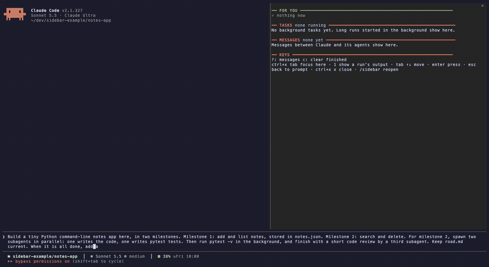

# session-sidebar

A side pane that opens in every Claude Code session (terminal 144 columns or wider; `/sidebar` opens it at any width).



Sections, top to bottom:

- **For you**: what is waiting on you, from `<session scratchpad>/for-you.md`: one `- headline` per item, with the link or command on indented `  - ` lines under it; `- [x]` hides it. Each item is one line, its words cut in the middle and its links last as short clickable labels (`↗ claude.ai`); click one marked ▸ to open it in full. An item that asks you to choose lists its options as `  - ( ) option` lines (`(*)` is Claude's pick); they show as buttons under it, and a press sends your pick to Claude and marks the item done. A new item raises a toast and a native notification.

- **Other sessions**: your other Claude sessions on this machine, read from their `road.md` and `for-you.md`. A session waiting on you comes first (⚑), then working ones (◆), then ones active in the last half hour. Each is one line; click it to see its road, the step in progress and what it waits on you for, with its links. To add your other machines, list ssh targets under **Other machines** in the plugin's settings (`/plugin`, or `pluginConfigs` in settings.json). Their sessions are then grouped under a heading per machine, and a click on the heading folds it. Each machine is read once a minute over ssh in BatchMode, so ssh to it once by hand first. The plugin sends a short read-only script and nothing else. A machine that fails is shown as unreachable and tried again in five minutes. Hidden when there are none.
- **Road so far**: the checklist Claude keeps at `<session scratchpad>/road.md` (`# Title`, then `- [x] done`, `- [~] now`, `- [ ] next`, `- [!] problem`, indented notes). Hidden when the file does not exist.
- **Tasks**: this session's background shell commands by their real description, with live state, run time and pass/fail counts for go test, Swift Testing, XCTest, pytest -v, jest/vitest and cargo test. Press a number to tail that task's output; the same number or `f` goes back to messages.
- **Agents**: subagents with their latest action.
- **Messages**: what agents sent each other and the lead, and agent finish notices.

Long runs raise a toast when they end (30 s or longer) and a native notification (5 min or longer). No gray text anywhere.

## Install

At the prompt of a Claude Code terminal session:

```
/plugin install session-sidebar --marketplace katyella/session-sidebar
```

Answer `y` to add the marketplace, then pick a scope (the user scope puts it in every session). The sidebar opens in that session right away.

From a shell instead:

```
claude plugin install session-sidebar --marketplace katyella/session-sidebar
```

A session that was already open does not see a shell install. Run `/reload-plugins` in it (no restart needed); sessions started afterwards load it on their own.

In the desktop app, where `/plugin` does not run: click + next to the prompt box, then Plugins, Add marketplace with `katyella/session-sidebar`, then Add plugin.

## Fill the For you and Road sections

Tasks, agents and messages fill in on their own. For you and Road so far show two files Claude keeps in its scratchpad folder, `for-you.md` and `road.md`. The plugin adds a short section to Claude's system prompt telling it to keep them, so there is nothing to set up: Claude adds a For you item before it asks you something, and keeps a Road checklist for any task with more than a few steps. Subagents and teammates leave both files to the main session.

On a Team or Enterprise plan, or on a machine with managed settings, Claude Code's built-in security plugin keeps the plugins you install out of the system prompt. There the sidebar sends the same section with your first prompt instead (you don't see it), and again after a `/clear` or a compaction. Nothing to set up there either.

## Change it

The whole sidebar is `hooks/register.tsx`. Ask Claude to change it, then run `/reload-plugins`.

## License

MIT. See [LICENSE](LICENSE).
